# Diagramas

La fuente de cada diagrama es su archivo `.mmd` (Mermaid). El `.svg` y el `.png` son exportaciones de esa fuente, listas para pegar en el documento.

Hay diagramas de dos momentos:

- **Corte 1**: el sistema entregado, en el tag `corte-1` (commit `8c37f83`). Estos diagramas quedan como registro del antes y no se actualizan.
- **Corte 2**: el sistema actual, con usuarios, administración, sensores, historial y tiempo real. Se ajustaron al código tres veces:
  - El 12 de octubre de 2026, con las cuentas, las plantas y los sensores.
  - El 18 de octubre, cuando la matera pasó a nacer con su sensor, se quitó la medición a mano y se agregó el WebSocket.
  - El 26 de octubre, con la fase 2 hexagonal: los puertos de entrada, los puertos de salida pequeños, los JWT, el canje de la clave del dispositivo y la tabla de referencia en la base o en CSV.

  Corresponden uno a uno con el repositorio.

## Índice

| Diagrama | Corte 1: entregado | Corte 2: código actual |
|---|---|---|
| [Vista hexagonal](#vista-hexagonal) | no existía | [`hexagonal`](hexagonal.png) |
| [Casos de uso](#casos-de-uso) | [`casos-de-uso-corte1`](casos-de-uso-corte1.png) | [`casos-de-uso-corte2`](casos-de-uso-corte2.png) |
| [Paquetes](#paquetes) | [`paquetes`](paquetes.png) | [`paquetes-corte2`](paquetes-corte2.png) |
| [Clases: dominio](#clases-del-dominio) | [`clases-dominio-corte1`](clases-dominio-corte1.png) | [`clases-dominio`](clases-dominio.png) |
| [Clases: puertos e implementaciones](#puertos-e-implementaciones) | [`clases-puertos-corte1`](clases-puertos-corte1.png) | [`clases-puertos`](clases-puertos.png) |
| [Clases: diagnóstico, plantas y dispositivos](#presentación-y-aplicación-diagnóstico-plantas-y-dispositivos) | [`clases-aplicacion-corte1`](clases-aplicacion-corte1.png) | [`clases-aplicacion`](clases-aplicacion.png) |
| [Clases: cuentas y administración](#presentación-y-aplicación-cuentas-y-administración) | no existía | [`clases-cuentas`](clases-cuentas.png) |
| [Entidad-relación](#entidad-relación) | [`entidad-relacion-corte1`](entidad-relacion-corte1.png) | [`entidad-relacion-corte2`](entidad-relacion-corte2.png) |
| [Secuencia: un diagnóstico](#secuencia-de-un-diagnóstico) | [`secuencia-diagnostico`](secuencia-diagnostico.png) | igual, con el repositorio de especies que elija la configuración |
| [Secuencia: lectura de un dispositivo](#secuencia-de-una-lectura-del-dispositivo) | no existía | [`secuencia-medicion-sensor`](secuencia-medicion-sensor.png) |
| [Secuencia: tiempo real](#secuencia-del-tiempo-real) | no existía | [`secuencia-tiempo-real`](secuencia-tiempo-real.png) |
| [Secuencia: login y «mis plantas»](#secuencia-de-login-y-mis-plantas) | no existía | [`secuencia-login`](secuencia-login.png) |
| [Secuencia: el admin agrega una especie](#secuencia-del-admin-que-agrega-una-especie) | no existía | [`secuencia-admin-especie`](secuencia-admin-especie.png) |

Al final está además la [vista general](#vista-general-diagrama-de-clases-del-backend) de Roger: el backend completo en un solo diagrama de PlantUML.

Los cuatro diagramas de clases del corte 2 no llevan sufijo porque muestran los dos cortes a la vez: **borde fino = corte 1, borde grueso = se agregó en el corte 2**, con la fase 2 incluida. Los `-corte1` muestran solo lo del corte 1.

## Convenciones

- **Clases y vista hexagonal:** el color indica la capa. Son los colores del diagrama de clases de Roger: morado para presentación, amarillo para aplicación, verde para dominio y azul para infraestructura.
- **Paquetes:** conservan los colores del diagrama entregado en el corte 1. En el del corte 2, los nodos nuevos son verdes y punteados.
- **Casos de uso del corte 2:** gris es un caso del corte 1, verde uno nuevo y oscuro uno exclusivo del administrador.
- **Nombres:** los de clases, atributos, métodos y archivos son los del código. Si el código cambia, se actualizan aquí (ver [Si cambia el código](#si-cambia-el-código)).

---

## Vista hexagonal

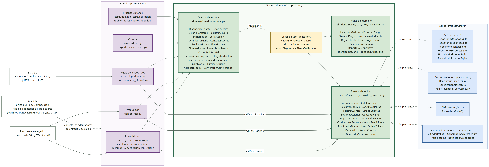

Fuente: [`hexagonal.mmd`](hexagonal.mmd). Fase 2.

Es el backend dibujado como puertos y adaptadores, con los nombres reales de archivos y clases. Las carpetas no cambiaron. Esta es la equivalencia:

| Parte del hexágono | Carpeta |
|---|---|
| Núcleo | `dominio/` y `aplicacion/` |
| Adaptadores de entrada | `presentacion/` |
| Adaptadores de salida | `infraestructura/` |
| Punto de composición | `main.py` |

- **A la izquierda, los adaptadores de entrada.**
  - Las rutas del front, el WebSocket y las rutas de los dispositivos.
  - Los comandos de consola (`crear_admin.py` y `exportar_especies_csv.py`) y las pruebas unitarias. No están en `presentacion/`, pero cumplen el mismo papel: llaman a un puerto de entrada, igual que una ruta.
- **Al centro, el núcleo.**
  - Los 21 puertos de entrada de `dominio/puertos_entrada.py`: uno por caso de uso, con su mismo nombre.
  - Los casos de uso de `aplicacion/`: cada uno hereda su puerto.
  - Las reglas del dominio.
  - Los 18 puertos de salida de `dominio/puertos.py` y `dominio/puertos_usuarios.py`.

  `DiagnosticarPlantaDeUsuario` no tiene puerto de entrada, porque solo lo usa `RegistrarLectura` desde adentro.
- **A la derecha, los adaptadores de salida:** SQLite, el CSV, los JWT y el resto (`seguridad.py`, `reloj.py` y `tiempo_real.py`).
- **Todas las flechas apuntan hacia el núcleo.** Las punteadas dicen «implementa»: la clase de afuera cumple una interfaz de adentro. El núcleo no conoce a ningún adaptador.
- **Los adaptadores de entrada también usan un puerto de salida: `VerificadorTokens`.** El token se verifica en el borde. Así el caso de uso recibe la identidad y nunca el token.
- **`main.py` es el único que conoce las dos mitades.** Elige el adaptador de cada puerto. Por ejemplo, con `MATERA_TABLA_REFERENCIA` elige SQLite o CSV para la tabla de especies.
- Lo comprueba [`tests/dominio/test_arquitectura.py`](../../backend/tests/dominio/test_arquitectura.py):
  - El dominio y la aplicación no importan frameworks, persistencia ni otras capas.
  - Presentación no importa infraestructura.
  - Los adaptadores de entrada conocen los puertos y no los casos de uso.
  - Solo `tokens_jwt.py` importa PyJWT, y solo el adaptador CSV sabe que existe un CSV.

## Casos de uso

Mermaid no tiene diagrama de casos de uso. Se dibujan como un flujo: los actores son cajas, los casos son óvalos y el recuadro es el sistema.

### Corte 1

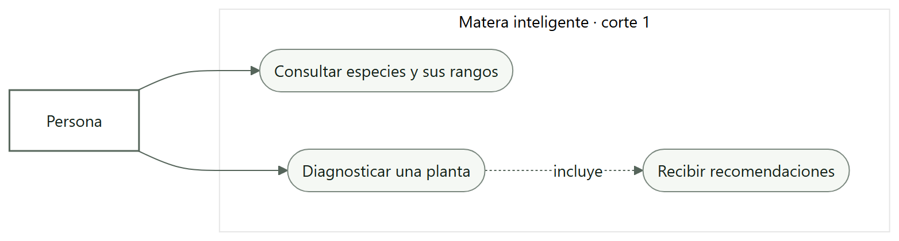

Fuente: [`casos-de-uso-corte1.mmd`](casos-de-uso-corte1.mmd).

- Hay un solo actor, anónimo, con dos casos: consultar las especies con sus rangos (RF5) y diagnosticar una planta (RF1 a RF4).
- Las recomendaciones no son un caso aparte: vienen incluidas en cada diagnóstico.

### Corte 2

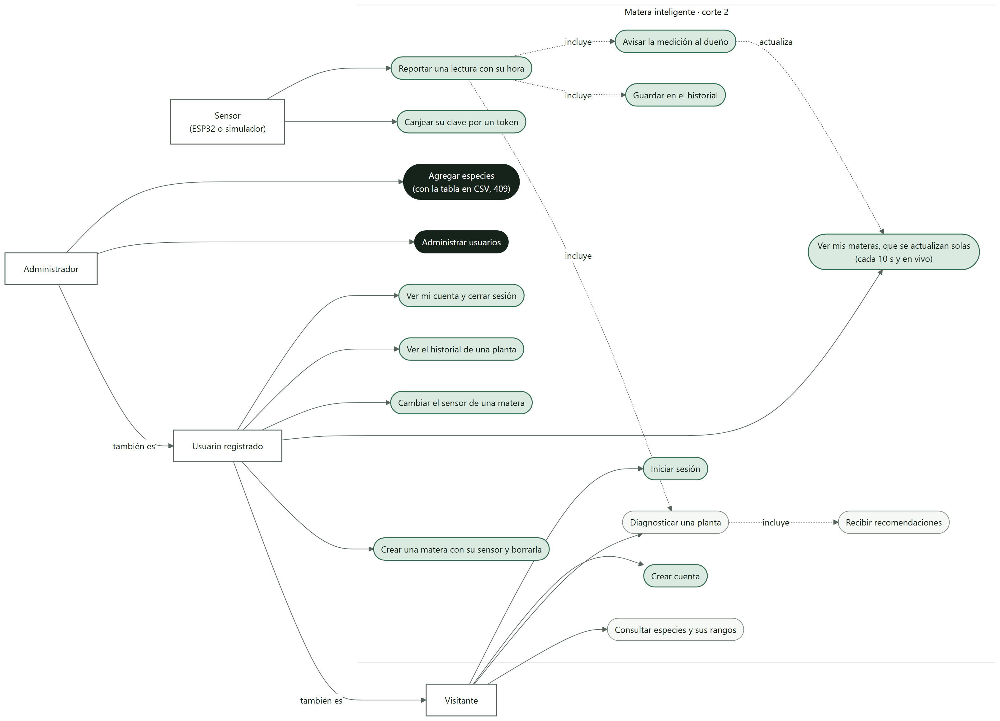

Fuente: [`casos-de-uso-corte2.mmd`](casos-de-uso-corte2.mmd).

- **Cuatro actores:**
  - El *visitante* es la persona sin cuenta. Desde la fase 2 (R7), solo puede crear una cuenta e iniciar sesión: consultar las especies y diagnosticar, que en el corte 1 eran anónimos, ahora piden sesión.
  - El *usuario registrado* también es visitante.
  - El *administrador* también es usuario, y por eso también tiene plantas.
  - El *sensor* es un actor sin persona: la ESP32 o el simulador, que le hablan a la API de la misma forma.
- **El sensor primero canjea su clave por un token** («Canjear su clave por un token»). Con ese token hace «Reportar una lectura con su hora».
- **El sensor no tiene su propia lógica de diagnóstico.** «Reportar una lectura con su hora» *incluye* «Diagnosticar una planta», el mismo caso de uso del corte 1. También incluye «Guardar en el historial» y «Avisar la medición al dueño».
- **Solo el sensor escribe en el historial.** No hay medición a mano.
- **Mis materas se actualiza sola:** cada 10 s vuelve a pedir sus datos, y además recibe cada medición por el WebSocket.
- **La matera nace con su sensor.** «Crear una matera con su sensor» pide el código del dispositivo. «Cambiar el sensor de una matera» reemplaza a vincular y desvincular, y conserva el historial.
- **Casos exclusivos del administrador:**
  - «Administrar usuarios» agrupa listar, desactivar y reactivar, dar y quitar el rol de admin, y eliminar cuentas.
  - «Agregar especies» solo lo puede hacer el admin, y solo con la tabla de referencia en la base: con la copia en CSV, la API responde 409.

## Paquetes

### Corte 1

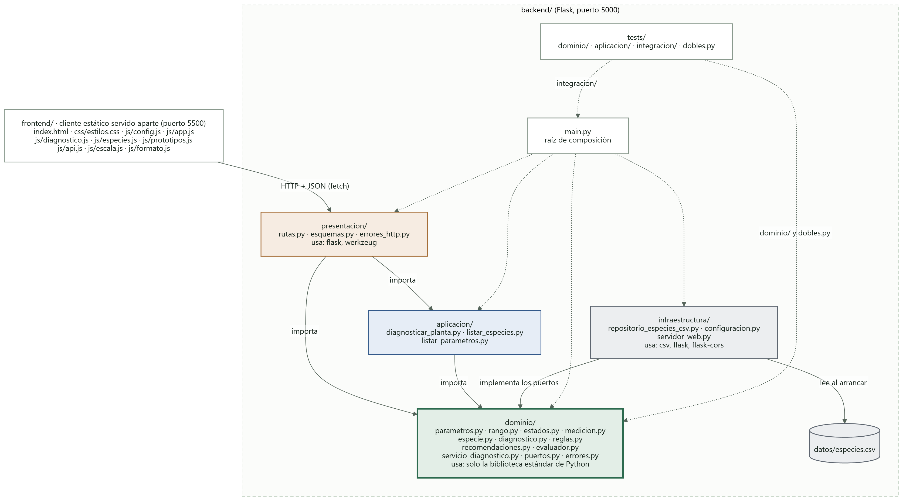

Fuente: [`paquetes.mmd`](paquetes.mmd).

- Cada caja es una carpeta real del repositorio y lista todos sus archivos, menos los `__init__.py`.
- Las flechas continuas son `import` del código de producción, en la dirección de la dependencia. Se sacaron leyendo los imports de cada archivo, no a mano.
- Las flechas punteadas son `main.py`, que arma todas las capas, y las pruebas.
- Ninguna flecha sale de `dominio/`.

### Corte 2

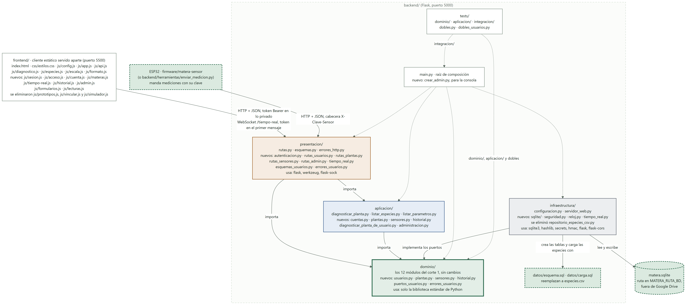

Fuente: [`paquetes-corte2.mmd`](paquetes-corte2.mmd).

- **La fase 2 quitó una flecha del corte 1: presentación ya no importa aplicación.** Las rutas y el WebSocket importan los puertos de entrada y los datos del dominio, y `main.py` les entrega el caso de uso. Ninguna dependencia nueva entre capas.
- Cada caja separa lo que ya estaba de lo `nuevo:` y de lo que `se eliminó`. El dominio conserva sus 12 módulos del corte 1 sin cambios.
- **Hay dos entradas más:** el ESP32 (`firmware/matera-sensor`) y el simulador (`simulador/simulador_esp32.py`). Llegan a presentación por HTTP, igual que el front, pero con el token del dispositivo. El simulador está fuera de `backend/`, no importa nada de él y solo usa la biblioteca estándar.
- **El tiempo real tampoco agrega dependencias entre capas.**
  - El front abre un WebSocket con `presentacion/tiempo_real.py`.
  - El aviso sale de `infraestructura/tiempo_real.py`, que implementa un puerto del dominio.
  - `main.py` le pasa a la ruta los mismos canales: presentación no importa infraestructura.
- **`especies.csv` vuelve, como copia de solo lectura de la tabla de especies.** La base sigue siendo `matera.sqlite`, que vive fuera de Google Drive (se configura con `MATERA_RUTA_BD`).
  - Con `MATERA_TABLA_REFERENCIA=csv`, el backend lee las especies del CSV. Si la copia no es igual a la tabla de la base, no arranca y pide regenerarla.
  - Con `bd`, el valor por defecto, las lee de la base y reescribe la copia cada vez que el admin agrega una especie.
  - `exportar_especies_csv.py` la regenera a mano.
- Junto a la base quedan su copia en CSV, salvo que se defina `MATERA_RUTA_CSV`, y el secreto con que se firman los JWT, salvo que se defina `MATERA_JWT_SECRETO`. Con la base por defecto, la copia es el `datos/especies.csv` del repositorio.
- **`main.py` es la única raíz de composición.** Los comandos de consola piden sus piezas a `main.construir_consola()`.

## Clases

Son cuatro diagramas, porque en uno solo no se leían las más de 60 clases. Juntan el diagrama de clases que Roger armó en PlantUML (commits `3987f72` y `6c43769`) con el corte 2.

| Se tomó del diagrama de Roger | Se tomó del diseño o se corrigió contra el código |
|---|---|
| Las capas como paquetes con color | Los nombres exactos del código (`minimo_fisico`, `fuera_de_rango`…) |
| Presentación e infraestructura dentro del diagrama | `Medicion` con `1..*` lecturas; `Especie` compuesta por sus `Rango`; retornos «o None» |
| La nota con los errores del dominio | Las flechas que faltaban: `ResultadoParametro → Rango` y `esquemas → Medicion` |
| Las dependencias por constructor, con el nombre del rol (`regla`, `evaluador`, `servicio`) | Las clases del corte 2 dentro de su capa, no en un paquete «usuarios» aparte |
| `ReglaAgregacion` como interfaz, y la reutilización de `ServicioDiagnostico` destacada | El formato Mermaid del resto de la carpeta, con SVG y PNG |

En estos diagramas los colores van en líneas `style`, una por clase. Mermaid acepta `classDef` y `cssClass` en diagramas de clases, pero no los dibuja.

### Clases del dominio

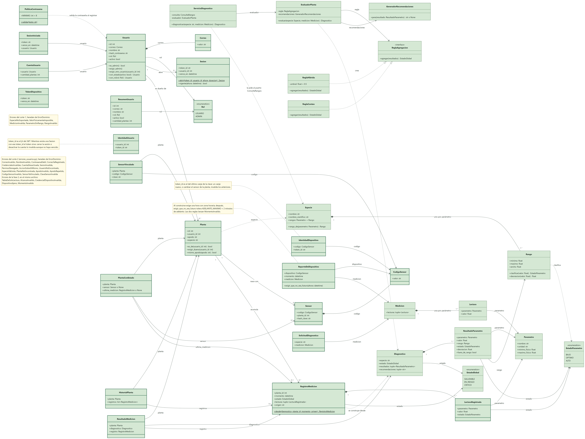

Fuentes: [`clases-dominio.mmd`](clases-dominio.mmd) (los dos cortes) y [`clases-dominio-corte1.mmd`](clases-dominio-corte1.mmd) ([imagen](clases-dominio-corte1.png), solo el corte 1).

- **El núcleo del corte 1.** `ServicioDiagnostico` usa a `EvaluadorPlanta`, que aplica una `ReglaAgregacion` (la híbrida o la de conteo) y el `GeneradorRecomendaciones` a una `Especie` y una `Medicion`, y crea un `Diagnostico`.
- **Lo nuevo:**
  - `Usuario` con su `Rol`, `Sesion`, `Planta`, y `Sensor` con su `CodigoSensor`.
  - `RegistroMedicion` para el historial, con su origen: el código del sensor (las mediciones a mano de antes conservan MANUAL).
  - De la fase 2: las identidades, el reporte del dispositivo y los datos de `resultados.py`.
- **Ninguna flecha sale de una clase del corte 1 hacia una nueva.** Son las nuevas las que dependen de las viejas: `Planta` apunta a `Especie` y `RegistroMedicion` se construye desde un `Diagnostico`. Por eso el corte 2 no modifica ningún módulo del dominio actual.
- **`Usuario.exigir_activo()` deja en pausa una cuenta desactivada:** no inicia sesión, y sus sensores no canjean su clave ni guardan lecturas.
- **`Usuario.exigir_admin()` es la regla de permisos de todo el sistema.** Si el usuario no es ADMIN, lanza `PermisoDenegado`. `Usuario.exigir_otro_usuario()` impide que un admin actúe sobre su propia cuenta.
- **`Planta.exigir_dueno(usuario_id)` es la regla de propiedad.** Si la planta es de otro, lanza `PlantaNoEncontrada`, el mismo error que una planta que no existe. El SQL ya no filtra por dueño: la decisión es del dominio.
- **`IdentidadUsuario` e `IdentidadDispositivo` son lo que queda de un token ya verificado:** de quién es y su `token_id` (el `jti` del JWT). Con ellas, ningún caso de uso ve el token.
- **`ReporteDeDispositivo`** es una lectura con la hora en que la tomó el dispositivo. Exige una hora con zona horaria y no acepta una hora adelantada en más de 2 minutos (`ADELANTO_MAXIMO`).
- **`dominio/resultados.py`** reúne los datos que entran y salen de los puertos de entrada: `SolicitudDiagnostico`, `SesionIniciada`, `SensorVinculado`, `PlantaConEstado`, `TokenDispositivo` y otros.
- Las dos notas de errores listan los de cada corte, y los de la fase 2 van con los del corte 2. Todos heredan de `ErrorDominio`.

### Puertos e implementaciones

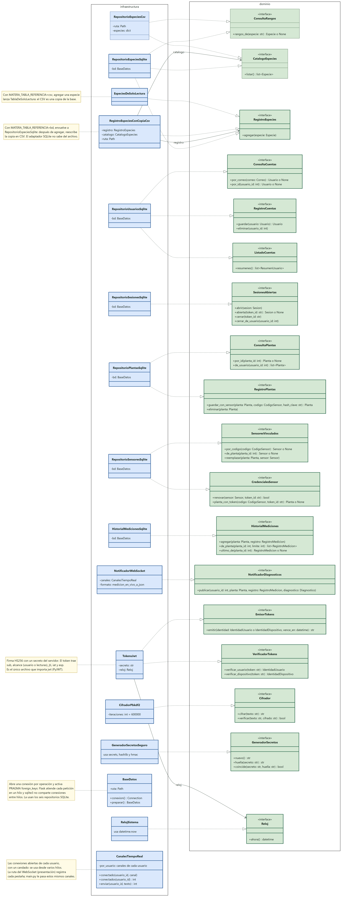

Fuentes: [`clases-puertos.mmd`](clases-puertos.mmd) y [`clases-puertos-corte1.mmd`](clases-puertos-corte1.mmd) ([imagen](clases-puertos-corte1.png)).

- **Todas las flechas van de infraestructura hacia el dominio (RA5, DIP).** El dominio declara la interfaz, e infraestructura la implementa. Este diagrama solo tiene los puertos de salida: los de entrada están en los dos diagramas de aplicación.
- **Hay 18 puertos de salida, con pocos métodos y nombres de negocio.** En el corte 1 había dos: `ConsultaRangos` y `CatalogoEspecies`.
  - La fase 2 partió los `Repositorio*` del corte 2. Por ejemplo, `RepositorioUsuarios` quedó como `ConsultaCuentas`, `RegistroCuentas` y `ListadoCuentas`.
  - Cada caso de uso pide solo lo que usa (ISP).
  - Las clases SQLite conservan sus nombres: `RepositorioUsuariosSqlite` implementa los tres.
- **La tabla de referencia tiene dos adaptadores.**
  - `RepositorioEspeciesSqlite` (la base) y `RepositorioEspeciesCsv` (la copia) implementan `ConsultaRangos` y `CatalogoEspecies`.
  - `RegistroEspecies` depende del modo. Con la base, `RegistroEspeciesConCopiaCsv` envuelve al registro de SQLite y reescribe el CSV después de agregar. Con el CSV, `EspeciesDeSoloLectura` lanza `TablaDeSoloLectura`, que da 409.
  - `main.py` elige según `MATERA_TABLA_REFERENCIA`. El adaptador SQLite no sabe que existe un CSV. Cambiar de tabla es el escenario 5.2 del documento: ningún cambio en el dominio.
- **`ConsultaPlantas.por_id(planta_id)` busca la planta sin mirar el dueño.** El caso de uso llama a `Planta.exigir_dueno`.
  - Las escrituras, `RegistroPlantas.eliminar(planta)` y `SensoresVinculados.reemplazar(planta, sensor)`, repiten en el SQL el id y el dueño de la planta que se leyó.
  - Así, si entre tanto la planta se borró y otra nueva tomó su id (SQLite reutiliza el id más alto), la escritura no toca la planta ajena.
- **Una matera no existe sin sensor.** `guardar_con_sensor()` crea la planta y su sensor en una sola transacción, y `reemplazar(planta, sensor)` cambia el sensor en otra. No hay un `guardar()` que cree una planta sola.
- **`CredencialesSensor` guarda el token vigente de cada sensor.**
  - `renovar(sensor, token_id)` lo cambia en el canje, solo si el sensor sigue siendo el mismo: código, planta y huella de la clave.
  - `planta_con_token(codigo, token_id)` devuelve la planta solo si ese token es el vigente.
  - Un canje nuevo o un cambio de sensor deja sin efecto el token anterior.
- **`TokensJwt` implementa `EmisorTokens` y `VerificadorTokens`.** Es el único archivo que importa PyJWT. El JWT lleva su alcance, «usuario» o «lecturas»: el token de un sensor no sirve en las rutas de usuario, ni al revés (403 `ALCANCE_INVALIDO`).
- **`NotificadorDiagnosticos` es el puerto del tiempo real.** Lo implementa `NotificadorWebSocket`, que arma el mensaje y se lo pasa a `CanalesTiempoReal`, el registro de las conexiones abiertas de cada usuario. Cambiar el WebSocket por MQTT sería escribir otra implementación del puerto, sin tocar el caso de uso.
- `Cifrador`, `GeneradorSecretos` y `Reloj` son puertos para que el dominio y la aplicación no importen `hashlib`, `secrets` ni la hora del sistema. En las pruebas, cada interfaz tiene un doble en memoria.
- **`BaseDatos` abre una conexión por operación** y activa `PRAGMA foreign_keys`. Flask atiende cada petición en un hilo y `sqlite3` no deja usar una conexión desde otro hilo: con una sola conexión compartida, el servidor real fallaba aunque las pruebas con `test_client` pasaran.

### Presentación y aplicación: diagnóstico, plantas y dispositivos

Fuentes: [`clases-aplicacion.mmd`](clases-aplicacion.mmd) y [`clases-aplicacion-corte1.mmd`](clases-aplicacion-corte1.mmd) ([imagen](clases-aplicacion-corte1.png)).

- **Las rutas dependen del puerto de entrada, no del caso de uso.** En el diagrama, el puerto lleva el prefijo `entrada.` (`entrada.ListarPlantas`) y el caso de uso que lo hereda va sin prefijo (`ListarPlantas`).
- **Las rutas del corte 1 responden igual, pero exigen sesión (R7).** `rutas` llama a `DiagnosticarPlanta`, `ListarEspecies` y `ListarParametros` a través de sus puertos, y cada ruta pasa por `Autenticacion.con_usuario`.
- **`esquemas` crea la `Medicion`.** Esa es la línea donde el dato deja de saber que llegó por HTTP (RA6). `esquemas_dispositivos.reporte_desde_json()` usa la misma `medicion_desde_json()` para el cuerpo del dispositivo, y además pasa la hora a UTC.
- **Cada ruta privada se autentica a su manera:**
  - `rutas_plantas` exige sesión con `Autenticacion.con_usuario`.
  - `rutas_dispositivos` no usa la sesión. Su decorador `_con_dispositivo` verifica el JWT del dispositivo con `VerificadorTokens.verificar_dispositivo` y le pasa a `RegistrarLectura` la `IdentidadDispositivo`.
- **`RegistrarPlanta` y `ReemplazarSensor` devuelven un `SensorVinculado`,** la planta con el código y la clave. Es la única vez que la clave sale del backend.
- **`CanjearClaveDispositivo` cambia esa clave por un `TokenDispositivo`,** que vence a las 24 horas.
- **La reutilización del núcleo:**
  - `RegistrarLectura` pasa la lectura a `DiagnosticarPlantaDeUsuario`.
  - Ese caso de uso busca la planta, exige que sea del dueño y llama a `ServicioDiagnostico`, el mismo del corte 1, sin cambios.
  - Después de guardar, avisa por el puerto `NotificadorDiagnosticos`. Si el aviso falla, la medición ya quedó guardada.
- **`tiempo_real` es la ruta del WebSocket.**
  - Verifica el JWT del primer mensaje con `VerificadorTokens.verificar_usuario`, y la sesión con `IdentificarUsuario`, el mismo caso de uso de las rutas HTTP.
  - Crea un `CanalWebSocket` por pestaña. Cada canal tiene su cola y su hilo emisor, y revisa la sesión antes de cada mensaje.

### Presentación y aplicación: cuentas y administración

Fuente: [`clases-cuentas.mmd`](clases-cuentas.mmd). Solo existe en el corte 2.

- `rutas_usuarios` maneja el registro, las sesiones y «Mi cuenta». `rutas_admin` maneja todo lo que es solo para el admin, bajo `/api/v1/admin`.
- **El token se verifica en el borde.**
  - `Autenticacion.con_usuario` verifica el JWT y le pasa la identidad a `IdentificarUsuario`, que revisa que la sesión siga abierta y la cuenta activa.
  - La ruta recibe el `Usuario`. `con_identidad` le entrega en cambio la `IdentidadUsuario`; solo la usa cerrar sesión.
  - Ningún caso de uso recibe el token.
- **`IniciarSesion` abre la sesión con su `token_id` y le pide el JWT a `EmisorTokens`.** Como la sesión es revocable, cerrar sesión o desactivar la cuenta invalida el token aunque no haya vencido.
- **Cada caso de uso de administración llama primero a `actor.exigir_admin()`.** La ruta no revisa el rol, y esconder la pestaña en el front no protege nada: la regla está en el dominio.
- **Siempre queda al menos un admin**, porque un admin no puede desactivarse, quitarse el rol ni eliminarse a sí mismo.
- `crear_admin` es el script de consola que crea el primer administrador. No pasa por la API: pide `ConvertirEnAdministrador` a `main.construir_consola()`.

Qué puertos usa cada caso de uso (en negrita, lo que ya existía en el corte 1). Cada uno hereda el puerto de entrada de su mismo nombre, salvo `DiagnosticarPlantaDeUsuario`:

| Caso de uso | Archivo en `aplicacion/` | Depende de |
|---|---|---|
| `DiagnosticarPlanta` | `diagnosticar_planta.py` | **ServicioDiagnostico** |
| `ListarEspecies` | `listar_especies.py` | **CatalogoEspecies** |
| `ListarParametros` | `listar_parametros.py` | ningún puerto: recibe la lista de parámetros |
| `RegistrarUsuario` | `cuentas.py` | ConsultaCuentas, RegistroCuentas, Cifrador |
| `IniciarSesion` | `cuentas.py` | ConsultaCuentas, SesionesAbiertas, Cifrador, GeneradorSecretos, EmisorTokens, Reloj y la duración de la sesión |
| `CerrarSesion` | `cuentas.py` | SesionesAbiertas |
| `IdentificarUsuario` | `cuentas.py` | SesionesAbiertas, ConsultaCuentas, Reloj |
| `ConsultarCuenta` | `cuentas.py` | ConsultaPlantas, para contar las plantas |
| `RegistrarPlanta` | `plantas.py` | ConsultaPlantas, RegistroPlantas, SensoresVinculados, **ConsultaRangos**, GeneradorSecretos |
| `ListarPlantas` | `plantas.py` | ConsultaPlantas, SensoresVinculados, HistorialMediciones |
| `EliminarPlanta` | `plantas.py` | ConsultaPlantas, RegistroPlantas |
| `ReemplazarSensor` | `sensores.py` | ConsultaPlantas, SensoresVinculados, GeneradorSecretos |
| `CanjearClaveDispositivo` | `sensores.py` | SensoresVinculados, CredencialesSensor, ConsultaPlantas, ConsultaCuentas, GeneradorSecretos, EmisorTokens, Reloj y la duración del token |
| `RegistrarLectura` | `sensores.py` | CredencialesSensor, ConsultaCuentas, Reloj, DiagnosticarPlantaDeUsuario |
| `DiagnosticarPlantaDeUsuario` (sin puerto de entrada) | `diagnosticar_planta_de_usuario.py` | ConsultaPlantas, **ServicioDiagnostico**, HistorialMediciones, NotificadorDiagnosticos |
| `ConsultarHistorial` | `historial.py` | ConsultaPlantas, HistorialMediciones |
| `ListarUsuarios` | `administracion.py` | ListadoCuentas |
| `CambiarEstadoUsuario` | `administracion.py` | ConsultaCuentas, RegistroCuentas, SesionesAbiertas |
| `CambiarRol` | `administracion.py` | ConsultaCuentas, RegistroCuentas |
| `EliminarUsuario` | `administracion.py` | ConsultaCuentas, RegistroCuentas |
| `AgregarEspecie` | `administracion.py` | **ConsultaRangos**, RegistroEspecies y el catálogo de parámetros |
| `ConvertirEnAdministrador` | `administracion.py` | ConsultaCuentas, RegistroCuentas |

## Entidad-relación

### Corte 1

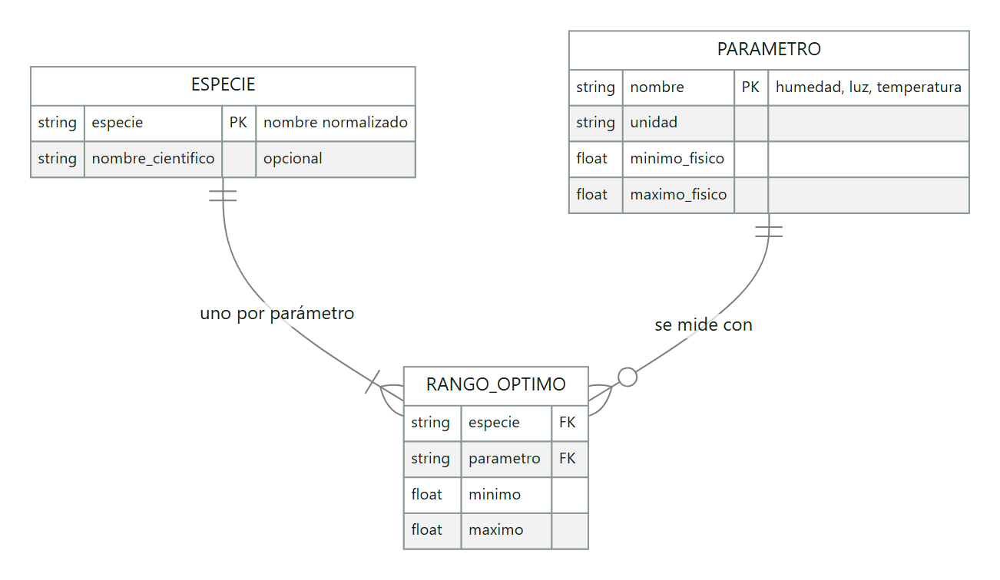

Fuente: [`entidad-relacion-corte1.mmd`](entidad-relacion-corte1.mmd).

- Es el modelo **conceptual**: en el corte 1 no hay base de datos. Físicamente es un solo archivo, `datos/especies.csv`, con una fila por especie y dos columnas (`_min` y `_max`) por parámetro.
- `PARAMETRO` no es una tabla sino las constantes de `dominio/parametros.py`.

### Corte 2

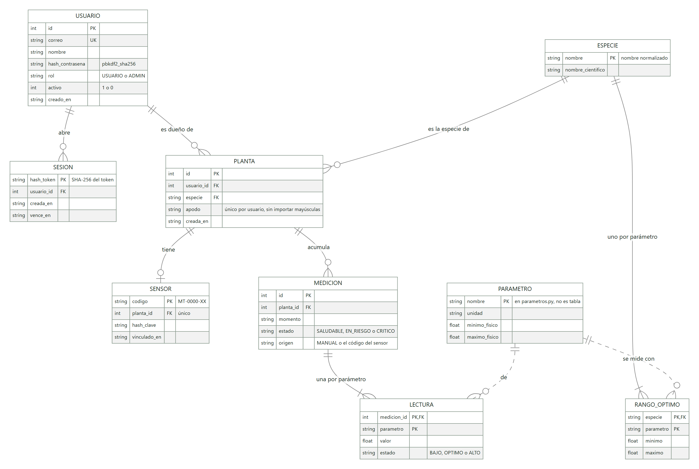

Fuente: [`entidad-relacion-corte2.mmd`](entidad-relacion-corte2.mmd).

- **Todo va en un solo archivo SQLite, con ocho tablas.** Cada planta tiene su `usuario_id`, y el dominio (`Planta.exigir_dueno`) rechaza la planta de otro usuario.
- **`ESPECIE` y `RANGO_OPTIMO` reemplazaron al CSV del corte 1.** `carga.sql` las llena con las mismas especies, rangos y fuentes. Desde la fase 2, `datos/especies.csv` es una copia de solo lectura de estas dos tablas.
- **`PLANTA.especie` es una llave foránea real,** también cuando la tabla de referencia es el CSV. No se puede registrar una planta con una especie inexistente, ni borrar una especie que alguna planta use.
- **`RANGO_OPTIMO` y `LECTURA` guardan una fila por parámetro**, así que agregar el pH no cambia el esquema.
- `USUARIO.rol` es USUARIO o ADMIN, y `USUARIO.activo` permite desactivar una cuenta sin borrarla.
- **Una matera nueva nace con su `SENSOR`,** en la misma transacción. La relación sigue siendo 0..1 por las materas creadas antes de que el sensor fuera obligatorio. Cambiar el sensor reemplaza esa fila y no toca `MEDICION`.
- **Ninguna tabla guarda un secreto.**
  - `SENSOR.hash_clave` es la huella SHA-256 de la clave.
  - `SESION.token_id` y `SENSOR.token_id` son el id (`jti`) del JWT, no el token. Si se cierra la sesión, o cambia el `token_id` del sensor, el token deja de servir aunque no haya vencido.
- **`MEDICION.momento` es la hora en que el dispositivo tomó la lectura, guardada en UTC.** `MEDICION.origen` es el código del sensor que la envió. Las mediciones escritas a mano antes del 18 de octubre conservan `MANUAL`.
- El esquema real está en [`backend/datos/esquema.sql`](../../backend/datos/esquema.sql). Las bases anteriores se migran solas al arrancar el backend (`PRAGMA user_version`), y antes se deja una copia de respaldo al lado.
- Borrar un usuario o una planta borra en cascada lo que depende de ellos. Las líneas punteadas llegan a `PARAMETRO`, que sigue en el código.

## Secuencias

### Secuencia de un diagnóstico

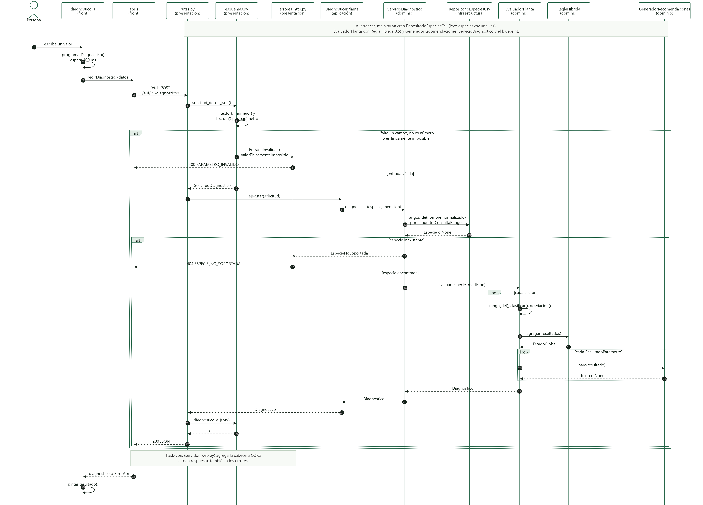

Fuente: [`secuencia-diagnostico.mmd`](secuencia-diagnostico.mmd).

Sigue una petición desde que la persona escribe en el front hasta que se pinta el resultado, con las funciones y clases reales. También muestra las dos salidas de error: 400 por entrada inválida y 404 por especie inexistente.

En el corte 2 este recorrido no cambia. Solo cambian tres cosas:

- La ruta exige el JWT de usuario (R7). Antes de llamar al caso de uso, `Autenticacion.con_usuario` lo verifica como en la [secuencia de login](#secuencia-de-login-y-mis-plantas).
- La ruta llama al puerto de entrada `DiagnosticarPlanta`, que hereda el caso de uso.
- El participante `P` es el repositorio que se configuró detrás del mismo puerto `ConsultaRangos`: `RepositorioEspeciesSqlite` o `RepositorioEspeciesCsv`, según `MATERA_TABLA_REFERENCIA`.

### Secuencia de una lectura del dispositivo

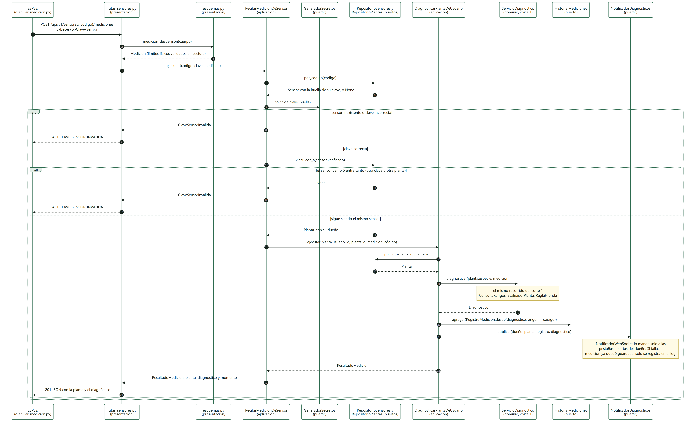

Fuente: [`secuencia-medicion-sensor.mmd`](secuencia-medicion-sensor.mmd). Corte 2, fase 2. El dispositivo es la ESP32 o el simulador: los dos hacen los mismos dos pasos.

- **Paso 1: el canje.** El dispositivo manda su clave a `POST /dispositivos/{código}/token`.
  - `CanjearClaveDispositivo` la compara con la huella guardada (`GeneradorSecretos.coincide()`). Un sensor inexistente y una clave incorrecta dan el mismo 401, para no revelar qué códigos existen.
  - Si la clave coincide, el caso de uso busca al dueño de la planta. Si su cuenta está desactivada, responde 403 `CUENTA_DESACTIVADA` (`Usuario.exigir_activo()`). Una clave incorrecta da el 401 de antes: el estado de la cuenta solo se revela a quien tiene la clave.
  - Si no, `CredencialesSensor.renovar()` deja el nuevo `token_id` como el único vigente, y `EmisorTokens` firma un JWT de alcance «lecturas».
- **Paso 2: la lectura.** El dispositivo manda `{dispositivo, momento, lecturas}` a `POST /dispositivos/{código}/lecturas` con `Authorization: Bearer`.
  - **HTTP termina en `rutas_dispositivos.py`.** `_con_dispositivo` verifica el JWT, y `esquemas_dispositivos` arma un `ReporteDeDispositivo`, con la hora en UTC y los límites físicos ya validados en cada `Lectura`.
  - **Cada rechazo tiene su código:**

    | Situación | Respuesta |
    |---|---|
    | El token es malo o venció | 401 `CREDENCIAL_DISPOSITIVO_INVALIDA` |
    | Es un token de usuario | 403 `ALCANCE_INVALIDO` |
    | El token es de otro sensor que el de la URL o el cuerpo | 403 `DISPOSITIVO_AJENO` |
    | La hora no tiene zona o está más de 2 minutos en el futuro | 400 `MOMENTO_INVALIDO` |
    | El dueño de la planta está desactivado, aunque el token siga vigente | 403 `CUENTA_DESACTIVADA` |
  - **Un token reemplazado no escribe.** `CredencialesSensor.planta_con_token()` solo encuentra la planta si ese token es el vigente. Si otro canje o un cambio de sensor lo dejó sin efecto, da 401, y la placa vuelve a canjear su clave.
- **`ServicioDiagnostico` es el del corte 1, sin cambios.** `DiagnosticarPlantaDeUsuario` busca la planta, exige que sea del dueño (`Planta.exigir_dueno`) y la diagnostica. El resultado se guarda como `RegistroMedicion`, con la hora del dispositivo y el código del sensor como origen.
- **Después de guardar, se avisa en vivo** por el puerto `NotificadorDiagnosticos`: la pantalla del dueño se actualiza sola (ver la secuencia siguiente). Si el aviso falla, el dispositivo igual recibe su 201.
- Con MQTT solo cambiarían el primer participante y el adaptador que lo recibe. Desde `RegistrarLectura` en adelante, todo queda igual.

### Secuencia del tiempo real

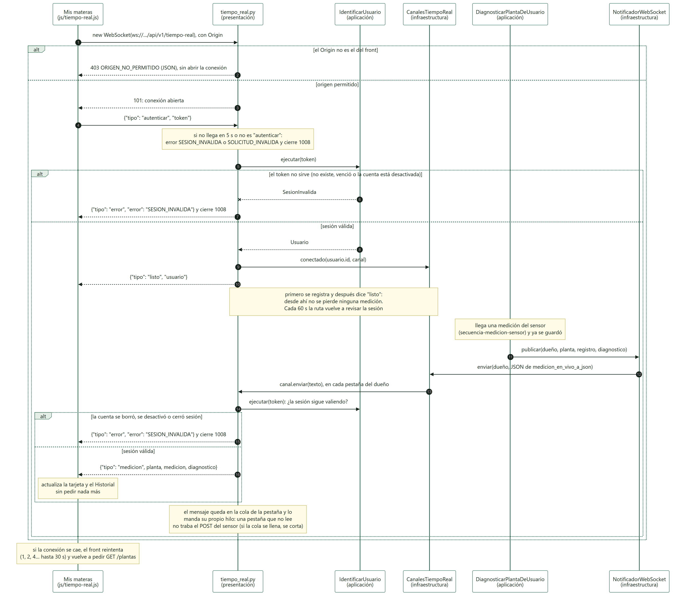

Fuente: [`secuencia-tiempo-real.mmd`](secuencia-tiempo-real.mmd). Corte 2, desde el 18 de octubre; con JWT desde la fase 2.

- **El Origin se revisa antes de aceptar la conexión.** CORS no aplica a los WebSocket, así que la ruta compara el Origin con los mismos orígenes del front. Otro origen recibe 403 en JSON.
- **El JWT va en el primer mensaje.** El navegador no deja poner `Authorization` en un WebSocket, y una URL con el token queda en los registros.
  - `VerificadorTokens.verificar_usuario` revisa la firma, el vencimiento y el alcance. Un token de sensor da `ALCANCE_INVALIDO`.
  - `IdentificarUsuario`, el mismo caso de uso de las rutas HTTP, revisa con la identidad que la sesión siga abierta.
- **Primero se registra el canal y después se dice «listo».** Desde ese mensaje no se pierde ninguna medición.
- **El aviso solo llega al dueño.** `CanalesTiempoReal` agrupa las conexiones por usuario.
  - La firma se verifica una sola vez, al conectar. Antes de cada mensaje, el canal vuelve a revisar la sesión con la identidad.
  - Así, una pestaña de una cuenta borrada nunca recibe las mediciones de la cuenta nueva que hereda su id (SQLite reutiliza el id más alto).
- **Una pestaña lenta no traba al dispositivo.** El mensaje queda en la cola de la pestaña y lo manda su propio hilo. Si la cola se llena, se corta esa conexión.
- **El WebSocket es un aviso, no la única vía.** Si la conexión se cae, el front reintenta y vuelve a pedir sus datos. Aunque no haya conexión, Mis materas consulta `GET /plantas` cada 10 s. La medición nunca se pierde: se guardó antes de avisar.

### Secuencia de login y «mis plantas»

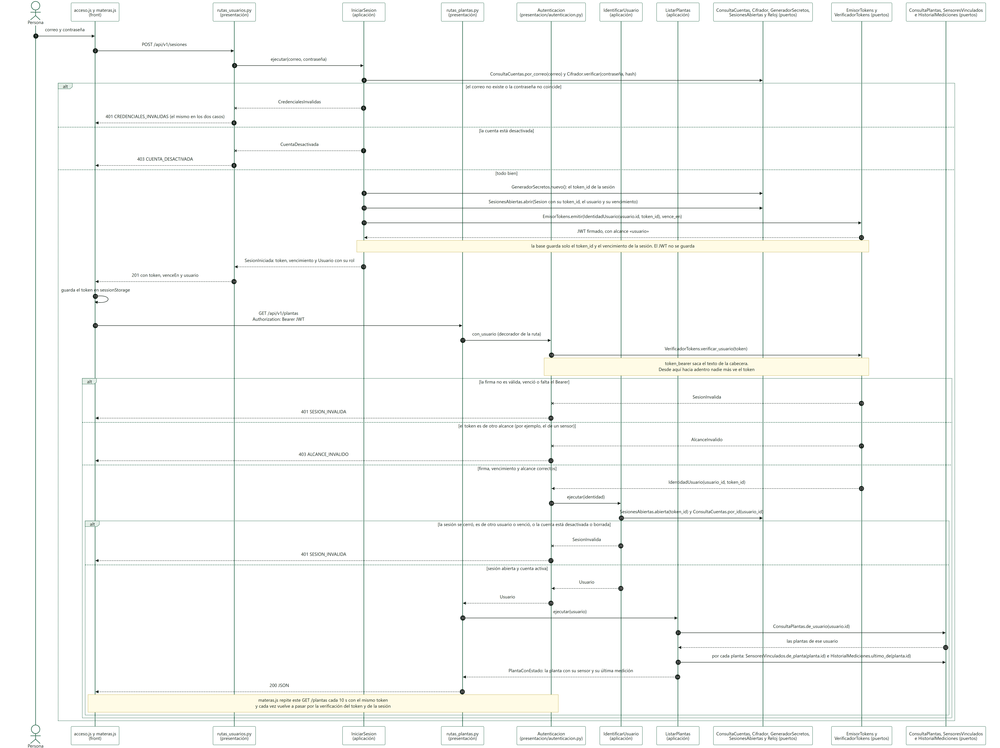

Fuente: [`secuencia-login.mmd`](secuencia-login.mmd). Corte 2, con JWT desde la fase 2.

- Si el correo no existe o la contraseña no coincide, la respuesta es el mismo 401. Una cuenta desactivada da 403, pero solo después de que la contraseña fue correcta.
- **`IniciarSesion` abre una sesión y emite un JWT** de alcance «usuario». La base guarda solo el `token_id` y el vencimiento; el JWT no se guarda. El front lo guarda en `sessionStorage`.
- **`Autenticacion` (`presentacion/autenticacion.py`) es donde el token deja de saber que existe HTTP.**
  - `token_bearer` saca el texto de la cabecera.
  - `VerificadorTokens` revisa la firma, el vencimiento y el alcance.
  - A `IdentificarUsuario` solo le llega la `IdentidadUsuario`.
- **El JWT es revocable.** `IdentificarUsuario` exige que la sesión de ese `token_id` siga abierta y que la cuenta esté activa. Cerrar sesión o desactivar la cuenta invalida el token aunque su firma siga siendo válida.
- `ListarPlantas` recibe el `Usuario`, y `ConsultaPlantas.de_usuario()` devuelve solo sus plantas.
- `materas.js` repite `GET /plantas` cada 10 s. Cada vez pasa por la misma verificación del token y de la sesión.

### Secuencia del admin que agrega una especie

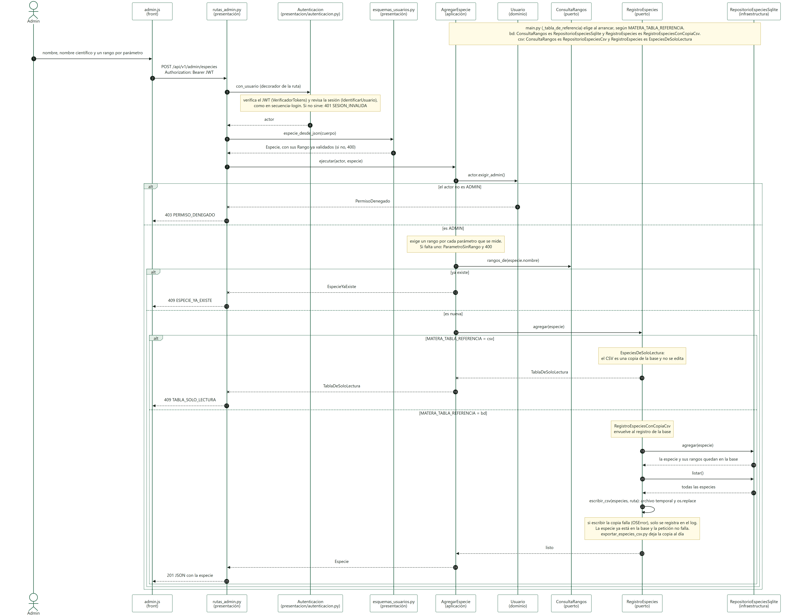

Fuente: [`secuencia-admin-especie.mmd`](secuencia-admin-especie.mmd). Corte 2.

- **El permiso se revisa en el caso de uso, con `actor.exigir_admin()`.** Si el actor no es admin, la respuesta es 403, venga del front o de cualquier otro cliente.
- La especie se arma con las mismas clases `Especie` y `Rango` del corte 1. Un rango con el mínimo mayor o igual que el máximo se rechaza con 400 antes de llegar al caso de uso.
- `AgregarEspecie` además exige un rango por cada parámetro que se mide; si falta uno, la respuesta es 400.
- Si la especie ya existe, la respuesta es 409.
- **El final depende de la tabla de referencia:**
  - Con `MATERA_TABLA_REFERENCIA=bd`, la especie se guarda en la base y aparece de inmediato en `GET /especies`, disponible para las plantas de cualquier usuario. Después, `RegistroEspeciesConCopiaCsv` reescribe la copia en CSV. Si eso falla, solo queda en el log: la especie ya está en la base, y `exportar_especies_csv.py` deja la copia al día.
  - Con `csv`, `EspeciesDeSoloLectura` rechaza la escritura y la respuesta es 409 `TABLA_SOLO_LECTURA`.

---

## Vista general: diagrama de clases del backend

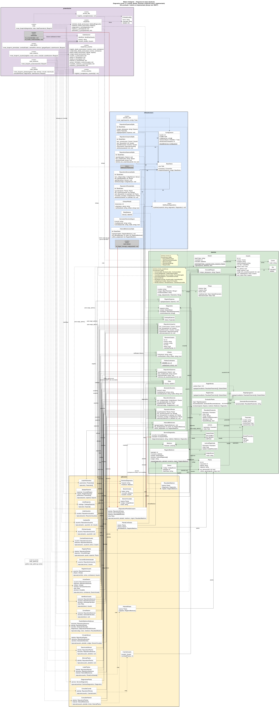

Propuesta de Roger del 1 de octubre, **revisada el 12 de octubre de 2026** para corregir las diferencias que tenía con el diseño aprobado del corte 2. Combina en una sola imagen las cuatro capas del backend más websocket y MQTT, marcados como futuro porque el diagrama se hizo antes del tiempo real. **No reemplaza los diagramas por capa de la sección anterior**: si contradice a alguno de ellos, vale el otro.

La primera versión (commit `d00df35`) se apartaba del diseño aprobado en varios puntos; esta revisión ya los corrige:

| Tenía la propuesta original | Tiene esta revisión, igual que el diseño aprobado el 12 de octubre |
|---|---|
| `VerificadorJwt`: token JWT | Token opaco: la base guarda su huella SHA-256 y su vencimiento, como `RepositorioSesiones` en el código de ese momento. |
| `RepositorioEspeciesCsv` | `RepositorioEspeciesSqlite`, igual que el código. |
| `rutas` usaba el decorador de autenticación | `rutas.py` sigue sin tocarse: Diagnóstico y Especies siguen siendo públicas. |
| Paquete «usuarios» aparte | Cada clase va en su capa real: dominio, aplicación, presentación o infraestructura. |
| `PlantaNoPertenece` (403) | `PlantaNoEncontrada` (404): una planta ajena responde igual que una inexistente. |

**Pendiente desde el 18 de octubre de 2026.** Este diagrama todavía no refleja el cambio de ese día, y Roger lo va a actualizar. Lo que ya no coincide con el código:

- El WebSocket (`presentacion/tiempo_real.py`), `NotificadorDiagnosticos` y `NotificadorWebSocket` ya existen, pero aparecen como futuro (websocket y `NotificadorWebSocket` en gris).
- El WebSocket no recibe mediciones ni llama a `DiagnosticarPlantaDeUsuario`: el front solo manda el token y el servidor empuja cada medición.
- `NotificadorDiagnosticos` es un puerto del dominio, con `publicar(usuario_id, planta, registro, diagnostico)`, no una interfaz de infraestructura con `publicar(usuarioId, diagnostico)`.
- `RegistrarPlanta` recibe también el código del sensor y devuelve un `SensorVinculado`. `VincularSensor` se reemplazó por `ReemplazarSensor`, y la medición a mano se quitó.

**Pendiente también desde la fase 2 (26 de octubre de 2026):**

- **Los tokens son JWT,** como proponía la primera versión, pero revocables: el servidor guarda su `jti` y los verifica `TokensJwt`. El dispositivo tiene su propio JWT, de alcance «lecturas», que obtiene canjeando su clave.
- **Las rutas del sensor son otras:** `POST /dispositivos/{codigo}/token` y `POST /dispositivos/{codigo}/lecturas`.
- **Cambiaron los puertos:**
  - Los `Repositorio*` se partieron en 18 puertos pequeños.
  - Hay puertos de entrada, que heredan los casos de uso.
  - La propiedad de una planta la decide `Planta.exigir_dueno`.
- **`RepositorioEspeciesCsv` volvió**, como copia de solo lectura elegida por configuración.
- **`rutas` sí usa el decorador de autenticación,** como en la primera versión: Diagnóstico, Especies y Parámetros exigen el JWT de usuario (R7).

Puede haber más diferencias: para todo lo del 18 de octubre en adelante valen los diagramas por capa y la vista hexagonal. Solo `mqtt_listener` sigue de verdad sin código (MQTT es el escenario 5.1 del documento).

**Nivel de detalle:** el corte 2 agregó unas 20 clases de caso de uso y varios repositorios SQLite; dibujar cada una por separado hacía el diagrama ilegible. Por eso, igual que el corte 1 solo mostraba `RepositorioEspeciesCsv` como único repositorio, aquí varias clases con el mismo patrón se agrupan en una sola caja (por ejemplo, `ListarUsuarios, CambiarEstadoUsuario, CambiarRol, EliminarUsuario, AgregarEspecie` comparten caja porque todas empiezan con `actor.exigir_admin()`). Para el detalle clase por clase, use los diagramas por capa de la sección anterior.

Fuente: [`clases-backend-general.puml`](clases-backend-general.puml) (PlantUML, no Mermaid). Para regenerar la imagen: `java -jar plantuml.jar -tpng clases-backend-general.puml` (si se recorta, agregar `-DPLANTUML_LIMIT_SIZE=8192`).

---

## Si cambia el código

Los diagramas del corte 2 y la vista hexagonal tienen que seguir correspondiendo uno a uno con el repositorio. Si se agrega, se renombra o se mueve un archivo, o cambia un import entre capas:

1. Edite el `.mmd`.
2. Pegue su contenido en <https://mermaid.live> y exporte el SVG y el PNG con el mismo nombre. También se puede exportar con `npx @mermaid-js/mermaid-cli -i paquetes-corte2.mmd -o paquetes-corte2.svg`.
3. Revise la explicación de ese diagrama en este archivo.

Los del corte 1 (`-corte1`, `paquetes` y `secuencia-diagnostico`) son el registro de lo entregado en el tag `corte-1`: no se actualizan.
